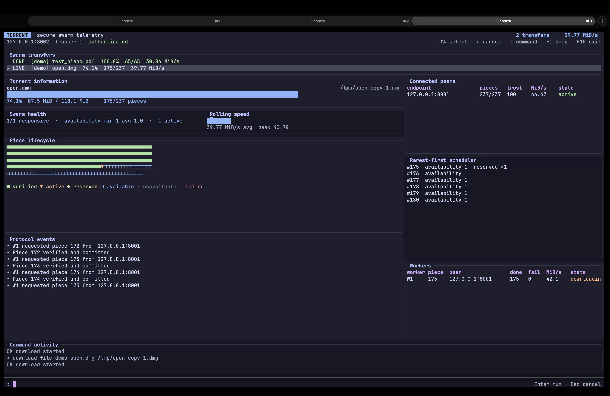

# Torrent Atlas

Torrent Atlas is an interview-sized BitTorrent-style file sharing system written in C++17. It keeps the hard parts visible: replicated tracker metadata, deterministic load balancing, direct peer transfer, framed TCP, AES-256-GCM piece exchange, SHA-1 integrity checks, resumable parallel downloads, rarest-first scheduling, a CLI, and an optional FTXUI dashboard.



## Architecture

```text
clients ── framed TCP ──> load balancer :5000
                              │
                    ┌─────────┴─────────┐
                    v                   v
               tracker 1 :6000 <──> tracker 2 :7000

peer :8001 <──── encrypted piece traffic ────> peer :8002
```

The load balancer is the only supported tracker endpoint for clients. It uses stable FNV-1a hashing for user and group ownership, and the tracker tag embedded in session IDs for session-only commands. Mutations are serialized at the LB; reads may run concurrently.

Each tracker applies local mutations in sequence and replicates them as `S\t<origin>\t<sequence>\t<session>\t<command>`. Replicas deduplicate old sequences and queue gaps. A successful mutation is returned only after immediate replication has been attempted. If the peer is unavailable, the mutation remains in an ordered in-memory retry queue.

`STATUS` and sequence-aware `SNAPSHOT` messages expose each tracker’s applied vector. Normal shard ownership resumes only when both vectors match. A replica that encounters an impossible replay conflict marks itself degraded and stays out of LB rotation until restart and snapshot recovery.

For the wire formats and failure-state details, see [ARCHITECTURE.md](ARCHITECTURE.md).

## Build and test

Requirements: CMake 3.16+, a C++17 compiler, OpenSSL, and network access during the default FTXUI configure.

```sh
cmake -S . -B build
cmake --build build -j
ctest --test-dir build --output-on-failure
```

FTXUI is enabled by default. For a dependency-light CLI build:

```sh
cmake -S . -B build -DTORRENT_ENABLE_FTXUI=OFF
```

The Makefile is only a convenience wrapper:

```sh
make build
make test
make sanitize
make clean
```

## Local demo

Committed example configs use LB `5000`, tracker 1 `6000`, and tracker 2 `7000`.

```sh
./build/tracker config/trackers.conf 1
./build/tracker config/trackers.conf 2
./build/tracker_lb config/load_balancer.conf
./build/client 127.0.0.1:8001 config/client.conf
./build/client 127.0.0.1:8002 config/client.conf --tui
```

Common commands accept either spaced or underscore spelling:

```text
create user alice secret
login alice secret
create group demo
join group demo
list requests demo
accept request demo bob
upload file demo /path/to/file.bin
list files demo
download file demo file.bin /tmp/file.bin
show downloads
show peers
cancel download file.bin
stop share demo file.bin
logout
quit
```

## Five-minute interview demo

1. Start both trackers and the LB; point out that clients know only `:5000`.
2. Start two clients, create Alice and Bob, create a group, join it, and accept Bob.
3. Upload a multi-piece file from Alice and download it from Bob. Show rarest-first piece state and live throughput in the TUI.
4. Stop the owner tracker. Create another group or share another file through the LB to demonstrate survivor writes.
5. Restart the tracker. Explain snapshot recovery and show that ownership fails back only after applied vectors match.

The useful interview tradeoff is deliberately narrow: this is ordered primary/replica metadata with deterministic ownership, not consensus. That makes failover and catch-up concrete without hiding the direct peer-transfer path behind a large framework.

## Transfer behavior

- 4-byte big-endian length-prefixed TCP frames with a 16 MiB cap.
- 512 KiB pieces and parallel rarest-first scheduling.
- AES-256-GCM peer requests and responses with authenticated context.
- Assignment-required SHA-1 per-piece and full-file verification.
- Resume manifests that re-hash claimed pieces before reuse.
- Partial seeding as pieces are verified.
- Retry from another available peer after disconnect, authentication failure, or corruption.
- Explicit cancellation and joined client service lifecycles.
- Factual peer availability, throughput, success, and failure metrics; no trust score or blacklist heuristic.

## Design limits

- The LB is a single point of failure.
- Tracker state, sequence counters, snapshots, and retry queues are in memory. Total tracker shutdown loses metadata.
- Tracker traffic assumes a trusted network and is not encrypted.
- SHA-1 is retained because the assignment requires it; it is not recommended for new security designs.
- Ordered replication plus catch-up-gated failback is not consensus and is not a general CRDT design.
- Peer authorization uses tracker-issued file capabilities; it is not an internet-facing identity system.

## Documentation

- [ARCHITECTURE.md](ARCHITECTURE.md): architecture, routing, protocol, and recovery.
- [TECHNICAL_REPORT.md](TECHNICAL_REPORT.md): implementation choices and tradeoffs.
- [SECURITY.md](SECURITY.md): threat model and cryptographic notes.
- `design.pdf`: original assignment specification.
